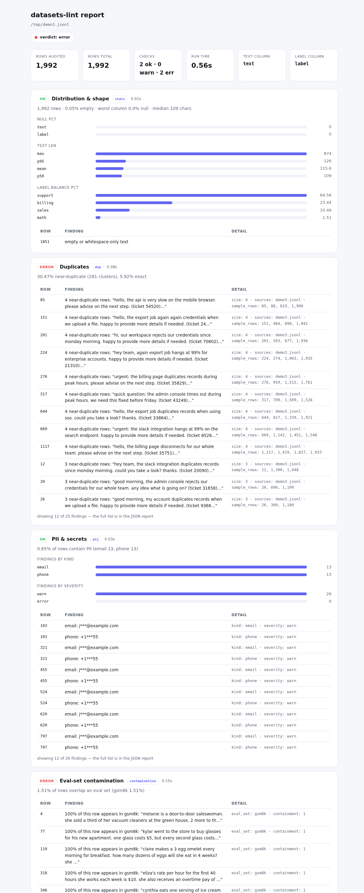

# datasets-lint

**ruff for training data.** Audit a dataset for duplicates, PII, distribution problems,
label conflicts, schema violations and eval-set contamination — then **fix it** — offline,
on CPU, in one command, with CI-friendly exit codes.

[](https://pypi.org/project/datasets-lint/)
[](https://github.com/horizonbymuneeb/datasets-lint/actions/workflows/ci.yml)
[](LICENSE)
[](https://github.com/marketplace/actions/datasets-lint)



```console
$ uvx datasets-lint run train.jsonl --report out.html
  ✓ stats           120,000 rows · 0.00% empty · worst column 0.0% null
  ✗ dup             18.20% near-duplicate (4,211 clusters), 12.00% exact
  ✗ pii             0.41% of rows contain PII (email 487, phone 12, api_key 1)
  ✗ contamination   3.10% of rows overlap an eval set (gsm8k 3.10%)
  ✓ schema          schema ok (2 columns)
  ✓ leakage         no label conflicts

  verdict: error — 3 errors, 0 warnings, 3 ok · 13.43s
  report → out.html
```

## Install

```console
uvx datasets-lint --help        # run without installing
pip install datasets-lint
```

## The 30-second tour

```console
datasets-lint run data.jsonl                                  # audit
datasets-lint run data.jsonl --fix data.clean.jsonl           # codemod: dedupe, drop empties, redact PII
datasets-lint run data.jsonl --profile strict --report out.html
datasets-lint run data.jsonl --sarif out.sarif                # GitHub code scanning
datasets-lint run data.jsonl --baseline main.json             # did this PR make it worse?
datasets-lint checks                                          # list checks
```

Exit codes: `0` ok · `1` threshold breached · `2` usage error.

## Checks

| id | what it finds | default failure |
|---|---|---|
| `stats` | empty rows, nulls, length percentiles, label balance | >1% empty |
| `dup` | exact + near duplicates (MinHash/LSH, exact Jaccard verified), cross-file overlap | >2% near-dup |
| `pii` | emails, phones, IPs, IBANs, SSNs, API keys — **redacted** in reports | any secret |
| `contamination` | overlap with GSM8K / HumanEval / MMLU or your own eval sets | >1% overlap |
| `schema` | required columns, declared types, cardinality limits | missing column |
| `leakage` | identical texts with different labels (label noise) | >1% of rows |

Full reference: [docs/checks.md](docs/checks.md).

## Codemods (`--fix`)

Every repair is planned first, counted, and written to a **new** file — the input is
never touched.

```console
$ datasets-lint run train.jsonl --fix train.clean.jsonl
  fixes: 327 rows dropped (dup 326 · stats 1) · 26 redactions (email 13 · phone 13)
  fixed → train.clean.jsonl
```

| flag | meaning |
|---|---|
| `--fix OUT` | write the repaired dataset (`.jsonl` / `.json` / `.csv` / `.parquet`) |
| `--fix-only dup,pii` | run a subset of fixers |
| `--fix-keep first\|last` | which row of a duplicate cluster to keep |
| `--fix-pii redact\|drop` | redact in place (default) or drop the rows |
| `--fix-drop-contaminated` | also drop eval-set leaks (opt-in) |
| `--dry-run` | plan and report, write nothing |

Details and recipes: [docs/codemods.md](docs/codemods.md).

## Profiles, suppressions, config

```toml
[defaults]
profile = "strict"        # default | strict | ci | dev
sample = 100000
seed = 0
fail_on = "error"

[checks.dup]
max_near_dup_pct = 2.0

[[suppress]]              # auditable, expiring exceptions
check = "pii"
rows = [12, 13]
reason = "public support addresses, DATA-118"
expires = "2027-01-01"
```

Full reference: [docs/configuration.md](docs/configuration.md).

## CI & Marketplace

The Action is listed on the [GitHub Marketplace](https://github.com/marketplace/actions/datasets-lint)
(categories: code-quality, testing).

```yaml
- uses: horizonbymuneeb/datasets-lint@v1.1.0
  with:
    paths: data/train.jsonl data/test.jsonl
    fail-on: error
- uses: github/codeql-action/upload-sarif@v3
  with:
    sarif_file: datasets-lint.sarif
```

```yaml
- uses: horizonbymuneeb/datasets-lint@v1.1.0
  with:
    paths: data/train.jsonl data/test.jsonl
    fail-on: error
- uses: github/codeql-action/upload-sarif@v3
  with:
    sarif_file: datasets-lint.sarif
```

Pre-commit, Docker, baseline diffs: [docs/integrations.md](docs/integrations.md).

## Programmatic API

```python
from datasets_lint import audit, fix, Config

report = audit("train.jsonl", config=Config(profile="strict"))
print(report.worst.value)  # "ok" | "warn" | "error"

stats = fix("train.jsonl", "train.clean.jsonl", only=["dup", "pii"])
print(stats["dropped_by_fixer"], stats["redactions"])
```

## Plugins

Third-party checks are normal packages with an entry point — no fork, no vendoring.
See [docs/plugins.md](docs/plugins.md).

## Numbers

Measured on 4 vCPU / 8 GB, no GPU (a laptop-class cloud VM):

| workload | wall | peak RSS |
|---|---|---|
| 100k rows, 54 MB JSONL, all checks | 46 s | 1.4 GB |
| same, `--fix` included | 48 s | 1.5 GB |
| `contamination` alone, 100k rows | 4.5 s | — |

Deterministic: same file + config + seed ⇒ identical JSON report.

## Contributing

New checks are the best way to contribute: one file, one fixture, one test.
See [CONTRIBUTING.md](CONTRIBUTING.md) and the
[`good first issue`](https://github.com/horizonbymuneeb/datasets-lint/labels/good%20first%20issue)
list.

## License

MIT. Bundled eval data: GSM8K, HumanEval and MMLU, all MIT — see
`src/datasets_lint/data/eval/manifest.json` for sources and checksums.
